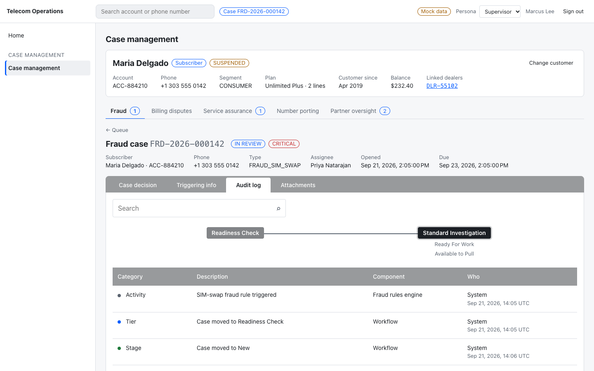
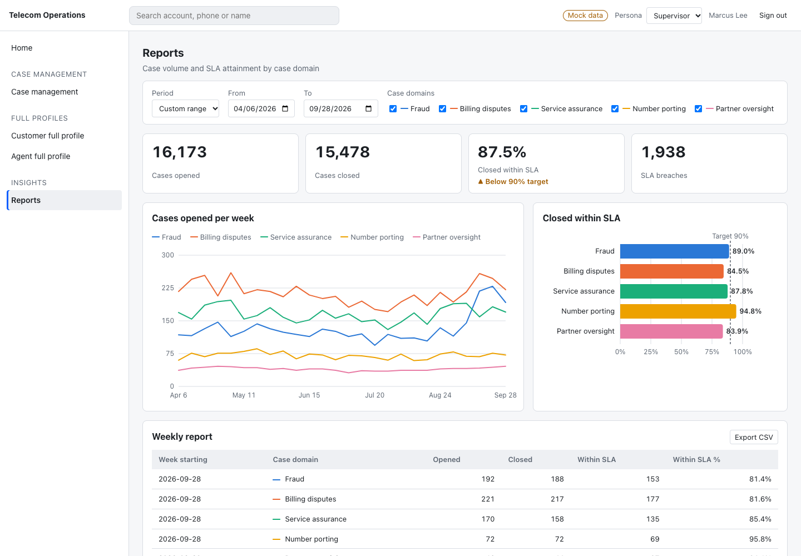

# Telecom Operations Platform

Micro-frontend platform for telecom case management, 360 views and reporting. It is an Nx monorepo with a **Native Federation** shell, layout families, and capability remotes, and it runs **mock-first** on MSW so no team waits on a backend.

> **Status:** Phases 0–5 are done and their gates are verified: foundations, shell, case management (five domains on one page with four-tab case screens), customer and agent full profiles, and reports. Every remote load is traced (see Troubleshooting). Next is Phase 6, backend cutover and hardening.





## Quick start
```bash
nvm use                 # Node 22 (Angular 21 needs >= 20.19)
npm i -g npm@11         # npm 10.9 cannot resolve this tree (ADR-0010)
npm ci
npm run start:all       # http://localhost:4200, signed in as a mock persona
```

| | |
| --- | --- |
| Run one remote standalone | `nx serve mfe-fraud` (dev harness on mocks) |
| Test / lint / build everything | `npm run test:all` · `npm run lint:all` · `npm run build:all` |
| Phase-gate E2E | `PW_CHANNEL=chrome npm run e2e` |
| Add a micro-frontend | `nx g @platform/tools:mfe <name> --kind=domain\|capability [--family=case\|360\|reporting] [--caseDomain=…]` |
| Build one app on its own | `nx build <app>` locally, or a GitLab pipeline with `APP=<app>` |

## Documentation
| Read this | For |
| --- | --- |
| [docs/architecture.md](docs/architecture.md) | How the pieces fit: runtime composition, layout levels, workspace map, quality gates |
| [docs/platform-handbook.md](docs/platform-handbook.md) | **Start here.** What was built, every decision ([ADR-0001](docs/platform-handbook.md#adr-0001)…0027) and why, lessons learned, verification state, assumptions to confirm |
| [docs/roadmap.md](docs/roadmap.md) | Phase status, gates, what to build next |
| [docs/guides/local-development.md](docs/guides/local-development.md) | Commands, ports, troubleshooting |
| [docs/guides/adding-an-mfe.md](docs/guides/adding-an-mfe.md) | The generator and what it wires up |
| [docs/guides/ci-cd.md](docs/guides/ci-cd.md) | GitLab pipelines, independent builds, variables, local dry run |
| [docs/guides/release-and-rollback.md](docs/guides/release-and-rollback.md) | Promotion and manifest rollback |
| [docs/guides/design-system-upgrades.md](docs/guides/design-system-upgrades.md) | Moving to a new `@org/design-system` version |
| [docs/guides/troubleshooting.md](docs/guides/troubleshooting.md) | **A section, tab or panel is "unavailable"**: log lines, error codes, `platformDiagnostics()`, `?logLevel=debug` |
| [docs/guides/code-conventions.md](docs/guides/code-conventions.md) | File headers, comments, Angular style, logging levels |
| [docs/guides/mocks-and-personas.md](docs/guides/mocks-and-personas.md) | MSW handlers, fixtures, personas, URL flags, endpoint → entitlement table |
| [docs/design-system-requests.md](docs/design-system-requests.md) | Components the platform needs from the design-system team |
| [.claude/skills/telecom-mfe-platform/SKILL.md](.claude/skills/telecom-mfe-platform/SKILL.md) | The rules and recipes for AI-assisted changes |

## Repository layout
```
apps/      shell · mfe-case-management (hub) · mfe-subscriber-view · mfe-partner-view · mfe-reporting · mfe-{fraud,billing-disputes,service-assurance,number-porting,partner-oversight}
           mfe-cap-{usage-billing,attachments,audit-trail,case-resolution,account-view,case-search,subscriber-search} · shell-e2e
libs/      contracts · mf-manifest · auth (+ auth/mock) · entitlements · utils · mocks · case-workspace · layout-360
tools/     generators (@platform/tools:mfe) · ci (plan/deploy/smoke/rollback) · scripts (guards) · vitest · eslint
ci/        GitLab job templates
vendor/    design-system tarballs (until the internal registry exists, ADR-0011)
docs/      platform-handbook · architecture · guides · roadmap
```
The design system is a **separate repo**: [`../design-system`](../design-system/README.md).
