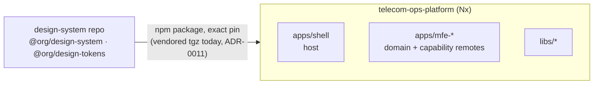
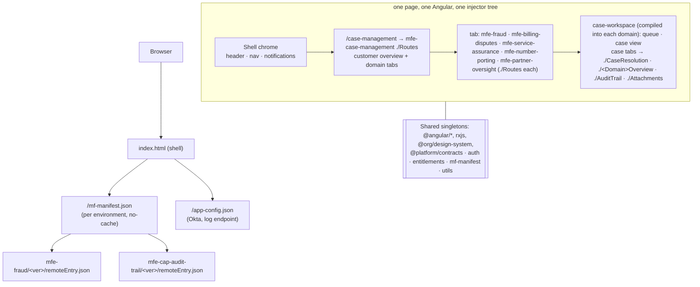

# Architecture overview

One Nx monorepo with a thin Native Federation **shell**, layout **families**, and **capability** remotes, all running on mock data first. Every rule below cites the decision (ADR-00NN) that set it; the reasons are in the decision register of [platform-handbook.md](platform-handbook.md).

## Repositories

The vendored-tarball arrangement is [ADR-0011](platform-handbook.md#adr-0011); the external-package policy is [ADR-0001](platform-handbook.md#adr-0001).

## Runtime composition

**Boot sequence** (`apps/shell/src/main.ts` → `bootstrap.ts`):
1. Fetch `mf-manifest.json`. A failure becomes `{}`.
2. `initFederation(manifest)`: shared packages and every *reachable* remote go into the import map.
3. `import('./bootstrap')`, then `setRemoteManifest`, `loadRuntimeConfig()`, `startMocks()` (mock builds only), `bootstrapApplication`.
4. App initializer: `auth.init()`, then `entitlements.load()`.

## Layout levels ([ADR-0002](platform-handbook.md#adr-0002), [ADR-0003](platform-handbook.md#adr-0003))
| Level | Owner | Case management | 360 | Reporting |
| --- | --- | --- | --- | --- |
| 1 App chrome | `apps/shell` | header, search, nav, notifications | same | same |
| 2 Family layout | lib or app | `libs/case-workspace` ✅ | `libs/layout-360` ✅ | inside `mfe-reporting` ✅ |
| 3 Page content | remotes | domain panels + capability tabs | profile sections | widgets |

## Workspace map (today)
| Path | Kind | Tags | Notes |
| --- | --- | --- | --- |
| `apps/shell` | host | `type:app family:host` | chrome, auth bootstrap, manifest, routes registry, legacy redirects |
| `apps/mfe-reporting` | reporting | `type:app family:reporting kind:domain` | `/reports`: dashboard with filters, charts, table, CSV export ([ADR-0027](platform-handbook.md#adr-0027)) |
| `apps/mfe-subscriber-view` · `apps/mfe-partner-view` | full profiles (360) | `type:app family:360 kind:domain` | `/customer-full-profile/:id`, `/agent-full-profile/:id` on `libs/layout-360` ([ADR-0024](platform-handbook.md#adr-0024), names: [ADR-0026](platform-handbook.md#adr-0026)) |
| `apps/mfe-cap-subscriber-search` | capability (header) | `type:app family:capability` | global search in the shell header; emits `OPEN_*_360` |
| `apps/mfe-case-management` | hub | `type:app family:case kind:hub` | `/case-management`: customer overview + one tab per case-domain remote ([ADR-0022](platform-handbook.md#adr-0022)) |
| `apps/mfe-fraud` | domain remote | `type:app family:case kind:domain` | exposes `./Routes` (queue + case screen at `/fraud`) and `./FraudOverview` (tab panel); owns `FRAUD_DOMAIN_CONFIG` |
| `apps/mfe-cap-usage-billing` | capability | `type:app family:capability kind:capability` | `./UsageBilling`: usage grid, flagged events (not on case screens since [ADR-0023](platform-handbook.md#adr-0023); for Customer full profile) |
| `apps/mfe-cap-attachments` | capability | same | `./Attachments`: list, upload, download; emits `ATTACHMENT_ADDED` |
| `apps/mfe-cap-audit-trail` | capability | same | `./AuditTrail`: **Audit log** tab: search, workflow track, Category/Description/Component/Who |
| `apps/mfe-cap-case-resolution` | capability | same | `./CaseResolution`: **Case decision** tab, typed form, domain codes via `CaseResolutionInputs` |
| `apps/mfe-cap-account-view` | capability | same | `./AccountView`: account → lines → devices (not on case screens since [ADR-0023](platform-handbook.md#adr-0023); for Customer full profile) |
| `apps/mfe-cap-case-search` | capability (embedded panel) | same | `./CaseSearch`: on Home; emits `OPEN_CASE` |
| `apps/mfe-billing-disputes` · `mfe-service-assurance` · `mfe-number-porting` | case domains | `type:app family:case kind:domain` | `/disputes` · `/assurance` · `/porting`; each exposes `./Routes` + its overview panel |
| `apps/mfe-partner-oversight` | case domain, 3 journeys | same | `/partners/{onboarding,ongoing,field-audit}`; one config per journey |
| `apps/shell-e2e` | Playwright | `type:e2e` | phase-gate tests |
| `libs/contracts` | `@platform/contracts` | `type:contracts scope:shared` | cross-MFE types, events, bus, case-context store, `RemoteName` |
| `libs/mf-manifest` | `@platform/mf-manifest` | `type:shared-lib scope:shared` | **the** shared federation config + loaders + manifests |
| `libs/auth` | `@platform/auth` | `type:shared-lib scope:shared` | `AuthService`, Okta, guard, interceptor, persona token |
| `libs/auth/mock` | `@platform/auth-mock` | `type:mocks scope:shared` | `MockAuthService` (never shared, never prod) |
| `libs/entitlements` | `@platform/entitlements` | `type:shared-lib scope:shared` | RBAC + flags, `entitlementGuard`, `*hasEntitlement` |
| `libs/utils` | `@platform/utils` | `type:shared-lib scope:shared` | logger, interceptors, formatters |
| `libs/case-workspace` | `@platform/case-workspace` | `type:layout family:case` | case layout, **queue**, header, tab host (+ `inputs`), resolver (compiled in, **not** shared) |
| `libs/layout-360` | `@platform/layout-360` | `type:layout family:360` | 360 banner, KPI strip, section grid, panel host (compiled in, **not** shared) |
| `libs/mocks` | `@platform/mocks` (+ `@platform/mocks/fixtures` for specs) | `type:mocks scope:shared` | MSW handlers, fixtures, mock DB, personas |
| `tools/generators` | `@platform/tools` | `type:tooling` | `mfe` generator |
| `tools/ci`, `tools/scripts` | Node scripts | | plan, deploy, smoke, rollback, guards |

## Communication channels (narrowest first)
| Need | Channel | Where |
| --- | --- | --- |
| Layout passes the case to a tab | component inputs `caseId`, `caseType` | `CaseCapabilityInputs` |
| Ambient state, one writer | signal store | `CaseContextStore` (writer: case view; readers: shell header badge, hub overview) · `CustomerContextStore` (writer: hub; reader: every case queue) |
| Something happened, or ask the shell to navigate | typed event bus | `CaseEventBus` + `CaseEvent` (versioned names): `ATTACHMENT_ADDED`, `CASE_RESOLVED`, `OPEN_CASE` |
| Auth, entitlements, flags | shell-provided singletons | `AuthService`, `EntitlementsService` (read-only for MFEs) |

## Quality gates
| Gate | Where |
| --- | --- |
| Module boundaries, OnPush, selector prefixes, no mocks outside `start-mocks.ts` | ESLint (`lint` target) |
| Shared-config drift | `npm run check:shared-config` |
| Unit tests (zoneless, MSW in Node) | `test` target (Vitest) |
| Budgets (shell initial < 800 kB; remote chunk < 300 kB) | `project.json` production configuration |
| No mocks in production bundles | `tools/scripts/check-no-mocks-in-prod.mjs` |
| Post-deploy contract | `tools/ci/contract-smoke.mjs` |
| No case-layout forks | `npm run check:case-domains` |
| File header comments | `npm run check:headers` |
| Phase gates | `apps/shell-e2e` |

Screenshots: [reports](images/reports-dashboard.png) · [customer full profile](images/customer-full-profile.png) · [agent full profile](images/agent-full-profile.png) · [audit log tab](images/case-audit-log-tab.png) · [case decision tab](images/case-decision-tab.png) · [customer-focused hub](images/case-management-customer.png) · [dispute case + resolution](images/dispute-case-resolution.png) · [account tab](images/case-account-tab.png) · [partner journeys](images/partner-journeys.png) · [case search](images/home-case-search.png) · [fraud queue](images/fraud-queue.png) · [case overview](images/case-overview.png) · [usage tab](images/case-usage-tab.png) · [audit tab](images/case-audit-tab.png) · [home](images/shell-home.png) · [remote loaded](images/shell-fraud-remote.png) · [remote down → fallback](images/shell-remote-fallback.png) · [capability dev harness](images/capability-dev-harness.png)

## Observability ([ADR-0025](platform-handbook.md#adr-0025))
One structured logger for the page (`[platform] time LEVEL source message {context}`, `sessionId`, `?logLevel=debug`). Every remote load is traced in `@platform/mf-manifest` (trace id, duration, error code + hint, history). `platformDiagnostics()` in the console summarises a session. See [guides/troubleshooting.md](guides/troubleshooting.md).
